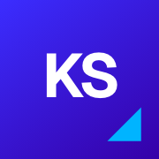
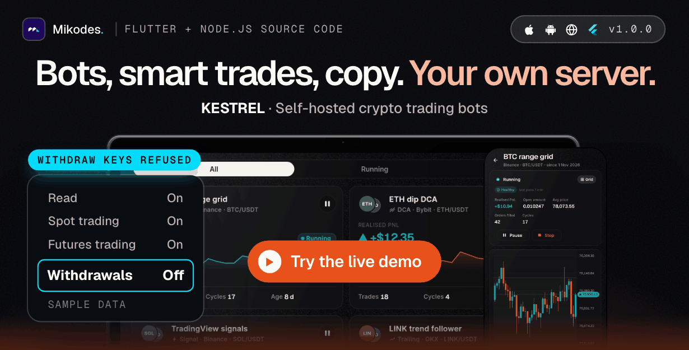
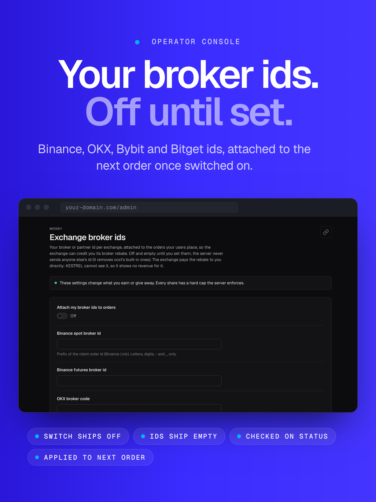
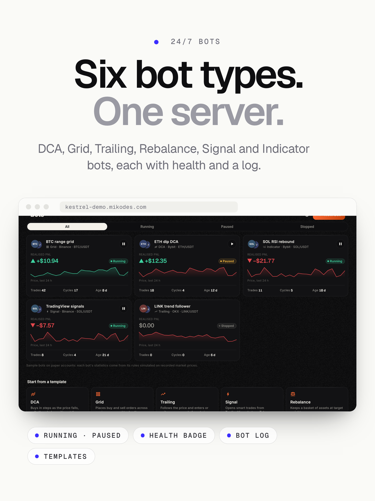
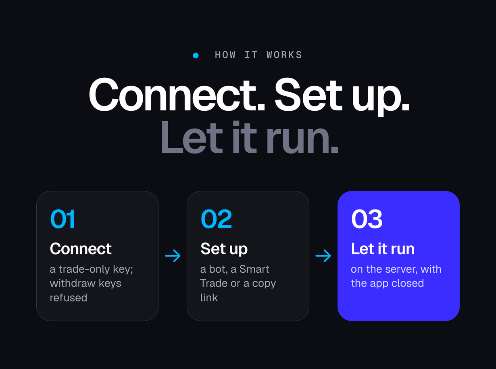
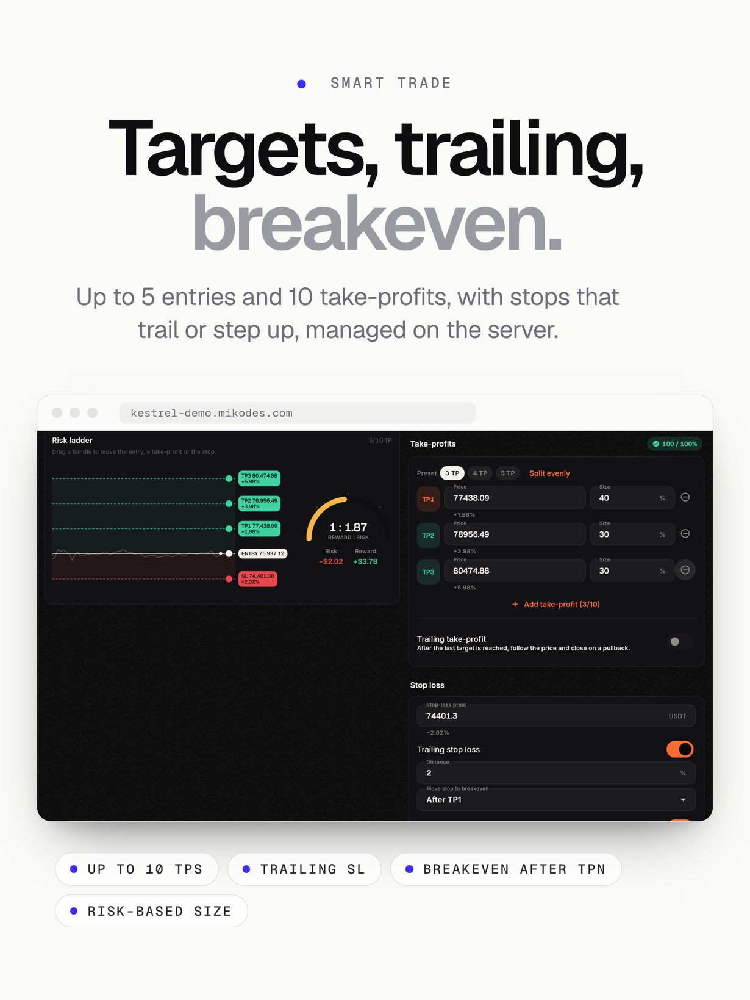
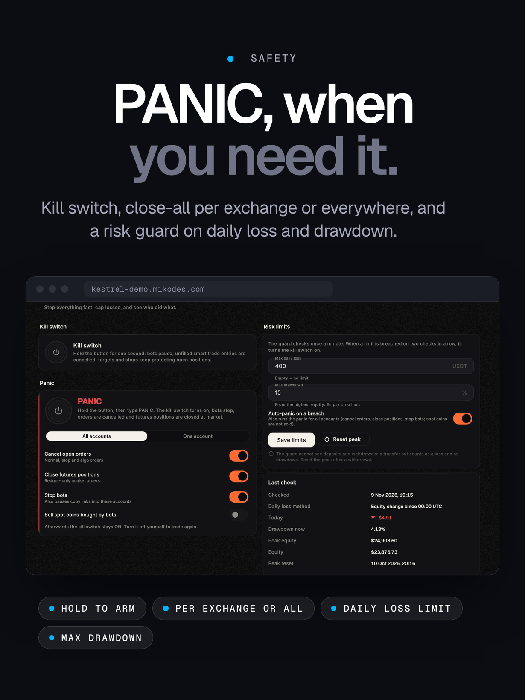
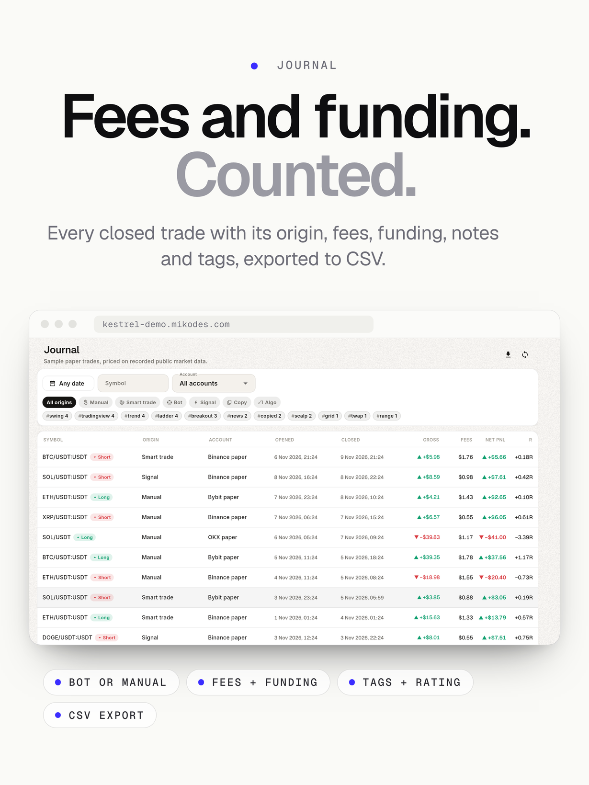

  

<h1 align="center">Kestrel</h1>

  <b>Crypto trading bots: a Flutter app with a Node.js server.</b>

  <a href="https://kestrel-demo.mikodes.com/"><b>▶ Live demo</b></a> ·
  <a href="https://store.mikodes.com/p/kestrel/"><b>Get the full source code</b></a>

  
  
  

  

> **This repository is a showcase.** It holds screenshots, documentation pointers and a real excerpt
> from the code. The full application is sold as source code at
> **[store.mikodes.com/p/kestrel](https://store.mikodes.com/p/kestrel/)**: one payment, instant ZIP download, free setup help.

---

## What it is

Users connect their own exchange accounts (Binance, OKX, Bybit, Bitget) with trade-only keys and run grid, DCA and signal bots in paper, testnet or live mode. Keys with withdraw permission are refused and stored encrypted.

## Screens

 

 

 

## Features

- **Exchange accounts with trade-only API keys**: Connect your own exchange accounts.
- **Encrypted key vault**: Keys stored encrypted on the operator's server.
- **Paper trading account filled from live prices**: Try every feature without keys or funds.
- **Markets, tickers, candles, order book, trades, best price across exchanges**: Live market data per exchange behind sign-in.
- **Trading terminal: candle chart with indicators, order ticket**: Manual spot and futures trading from phone, web or desktop.
- **Smart Trade: up to 5 entries, up to 10 take-profits, trailing TP, trailing SL, breakeven after TPn, SL steps,…**: Multi-target TP/SL managed on the server, works with the app closed.
- **Bots: DCA, Grid**: 24/7 automated strategies on the user's exchange accounts.
- **No-code indicator rule builder**: Build indicator strategies without code.
- **Backtest on historical candles**: Check a bot configuration against past candles before running it.
- **Bot presets and templates**: Start from sensible parameter sets.
- **Algo orders: TWAP and scaled**: Split large orders over time or price.
- **Signals: TradingView webhook per bot with secret, Telegram channel signal parser**: Execute TradingView alerts and Telegram signal posts automatically.

## How it works

A technical case study of the architecture, one end-to-end flow, the key engineering decisions and how you would build something like this: **[docs/HOW-IT-WORKS.md](docs/HOW-IT-WORKS.md)**.

## A look at the code

Real excerpts from the source, shown for illustration:

- **Position sizing** ([`snippets/position-sizing.ts`](snippets/position-sizing.ts)): Converts an order ticket into an exact amount, including risk-based sizing where the stop-loss distance decides the position. Decimal math and step flooring keep it exchange-safe.
- **API key permission check** ([`snippets/key-permissions.ts`](snippets/key-permissions.ts)): Reads what an exchange key may do and refuses keys that can withdraw or transfer. Anything unexpected in the exchange reply fails closed.
- **Signal confidence scoring** ([`snippets/signal-confidence.ts`](snippets/signal-confidence.ts)): A signal read from free text gets a confidence score. Missing exits, recap posts and numbers that contradict the side all lower it, and the bot acts only above a threshold.

Not included: Hosting, domain, TLS certificate and a fixed-IP server; Exchange accounts, API keys and any exchange trading fees or funding payments; Exchange broker/affiliate program approval; Apple Developer, Google Play and Firebase accounts; Firebase project for push notifications.

## Get the full source code

  

One payment, full licence, instant ZIP download and free setup help.
Questions: [mikodes.com/support](https://mikodes.com/support).

---

  Made by <a href="https://mikodes.com"><b>MIKODES</b></a> · <a href="https://github.com/Mikodesteam">more projects</a>

