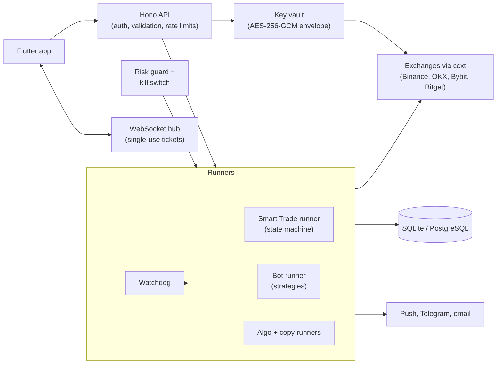

# How Kestrel works

A case study of a self-hosted multi-exchange crypto trading platform: a TypeScript server that holds
exchange API keys safely and runs trades and bots, plus a Flutter app (iOS, Android, macOS and web).
It is written from the real code; short verbatim excerpts are in [`../snippets/`](../snippets/).

## The problem and who it is for

Traders who automate (DCA, grids, take-profit ladders, copy trading) usually rent a hosted bot service,
which means handing a third party their exchange keys and paying a subscription. A team that wants to run
such a service for its own community needs the same pieces: encrypted key storage, order logic that
survives exchange errors, risk limits, notifications and a polished app. Kestrel is that stack for
Binance, OKX, Bybit and Bitget, with live, testnet and paper accounts. The operator hosts it; the users
bring trade-only API keys.

## Architecture

| Part | What it is |
| --- | --- |
| Server | Node.js 22, TypeScript, Hono for HTTP, Kysely on SQLite (or PostgreSQL), `ccxt` for exchange access, `decimal.js` for money, `zod` for validation, `ws` for WebSocket. |
| App | Flutter, with a terminal (charts, order ticket), bots, journal, scanner and settings. |
| Runners | Long-lived loops inside the server: Smart Trade runner, bot runner, algo (TWAP and ladder) runner, copy runner, alerts and the watchdog. |
| Operator console | An admin console for brand, access, plans, feature switches, exchange broker ids, integrations, users and the audit log. |
| Install | `install.sh` and Docker Compose, with an optional PostgreSQL profile and a Caddy-served web app with automatic HTTPS. |

## One flow end to end: a Smart Trade from ticket to exit

A Smart Trade is a position with up to five entries, up to ten take-profits, a stop-loss, a trailing stop
and optional breakeven and timeout rules.

1. **A key is added.** When a user connects an exchange account, the server asks the exchange what the key
   may do. A key that can withdraw or transfer funds is refused with a message telling the user to create
   a trade-only key. If the permissions cannot be read with certainty the key is also refused (see
   [`key-permissions.ts`](../snippets/key-permissions.ts)). Accepted secrets are sealed in the vault
   before they touch the database.
2. **The ticket is validated.** The request body goes through `zod` schemas, then the size is computed
   exactly in decimal arithmetic, including risk-based sizing where the stop-loss distance decides
   the position (see [`position-sizing.ts`](../snippets/position-sizing.ts)).
3. **Orders are normalised.** Before an order reaches the exchange, the amount is floored to the market's
   step, the price is rounded to the price step, and minimums are checked locally. A leverage and margin
   mode call is made first for futures.
4. **The state machine decides.** The Smart Trade engine is a pure function: `(state, event)` returns
   `(state, actions)`, with no I/O and no clock. Events are order fills, ticks and user commands;
   actions are "place this order", "cancel that one" or "write a log line".
5. **Two-phase replacement.** When an order must be replaced or removed, it is first marked "cancelling".
   New orders that depend on what is held (a market close, re-sized take-profits, a moved stop) are
   computed only after every relevant cancel is confirmed or turned out to have filled. A fill that races
   a cancel therefore cannot make the trade sell more than it holds.
6. **The runner executes the actions** under a lock per trade, so a scheduled tick and a user command
   never interleave. The result is stored and events are published to the app over WebSocket.
7. **Exits run even when new risk is blocked.** If the kill switch or the risk guard stops new orders, take
   profits and stop-losses keep working.
8. **The journal records the result** (fills, fees, funding), which feeds analytics and CSV exports.

## Key engineering decisions

### 1. Pure state machines with a thin runner around them

- **Chosen:** Smart Trade logic and bot strategies are pure functions of state and event. A runner owns
  I/O, locks and persistence.
- **Alternative:** write each bot as a loop that calls the exchange directly.
- **Why:** order logic is where money is lost. A pure function can be tested with scripted fills and
  failures, including the awkward ones (partial fills, a cancel racing a fill) without an exchange.

### 2. Decimal arithmetic everywhere money is touched

- **Chosen:** amounts and prices are strings in the API and `Decimal` in the code, floored to the
  exchange's step.
- **Alternative:** JavaScript numbers.
- **Why:** floating-point noise turns "exactly the step" into "one step too many", which an exchange
  rejects. Amounts are always rounded down so an order never asks for more than the balance.

### 3. Refuse keys that can withdraw, and refuse what cannot be verified

- **Chosen:** read the key's permissions from each exchange and fail closed on anything unexpected.
- **Alternative:** trust the user to create a restricted key and warn them in the docs.
- **Why:** the worst-case leak of a trade-only key is bad trades; the worst case of a withdraw key is
  an emptied account. Unknown values from an exchange (for example an authority name the code does not
  know) are not guessed at.

### 4. One kill-switch path with hooks, and exits keep running

- **Chosen:** one function sets the switch, writes an audit row, notifies the user and calls hooks on
  every runner. Bots cancel entries and pause, Smart Trades cancel unfilled entries, algo orders stop adding
  risk. The app route, the Telegram commands, the panic button and the risk guard all call the same code.
- **Alternative:** each feature checks its own flag.
- **Why:** with many runners, a separate path per trigger will eventually miss one. A shared hook
  list, where one failing hook does not stop the others, keeps the behaviour consistent.

### 5. Signals are read conservatively, with a confidence score

- **Chosen:** a signal parser for Telegram or TradingView text returns a confidence score, and the bot acts
  only above a threshold (see [`signal-confidence.ts`](../snippets/signal-confidence.ts)).
- **Alternative:** a looser parser that always returns its best guess.
- **Why:** channel posts are messy: recaps, negations ("don't buy") and swapped numbers are common. A call
  without exits is not treated as a signal, and numbers that contradict the side lower the score.

## Security and safety measures that exist in the code

- **Encrypted key vault.** Each secret gets a fresh 256-bit data key (AES-256-GCM), wrapped by a master
  key from the environment (also AES-256-GCM). Both layers are bound to the row and field by additional
  authenticated data, so a blob copied into another record fails to decrypt. Secrets are never returned
  by the API, and data keys are zeroed after use. An older unbound format is re-sealed at start.
- **Withdraw-capable keys are refused,** and so are keys whose permissions cannot be verified.
- **Single-use WebSocket tickets.** A ticket is 32 random bytes, bound to a user and session, valid for
  30 seconds and spent on first use.
- **Accounts:** email and password, optional TOTP two-factor, sessions and device list, email
  verification and an audit log of sensitive actions.
- **Risk guard.** Daily loss and drawdown limits. A breach must be seen on two consecutive checks before the
  guard acts, so one bad read cannot stop trading.
- **Panic.** An emergency stop that sets the kill switch first, then stops bots, closes or stops Smart
  Trades, cancels remaining orders and closes futures positions reduce-only. Every step is attempted even
  if another failed, and running it twice is harmless.
- **Watchdog.** Health states per bot and trade, exchange back-off on rate limits and one automatic
  re-schedule of a stalled loop. After an authentication error an account is left alone and probed
  at most once per window.
- **AI assistant drafts are validated, never executed.** The model's answer must pass the same schemas as
  a hand-made request, with extra limits on leverage and on the sum of take-profit sizes.
- **Telegram control bot.** Destructive commands need a typed confirmation, and a TOTP code when two-factor is
  on.
- **Demo mode.** Generated sample data, a permanent "sample" banner, no writes to the network.

## Testing approach

- The server has a large Vitest suite: per strategy, per engine, API tests, permission parsing, vault,
  risk and panic, health, journal and more, against fake exchange adapters.
- The pipeline `check` runs the type checker, the linter and the tests together.
- Backtests run on historical candles and are labelled as simulated.

## How you would build something like this

1. **Define the exchange boundary.** One adapter interface (markets, balances, orders, leverage,
   permissions). Everything else uses it, so a fake adapter can drive the whole test suite.
2. **Do money in decimals from day one,** with step-aware rounding helpers.
3. **Build the vault before the first key is stored.** Envelope encryption with context binding, and a
   migration path for format changes.
4. **Write the trade logic as pure state machines** and test them with event scripts, including races.
5. **Add runners with locks,** persistence of state after every step and a watchdog that can re-schedule a
   stalled loop.
6. **Add safety as a layer that reaches every runner:** one kill-switch path, a risk guard with
   confirmation counts, an emergency stop that tolerates partial failure.
7. **Then add the surface:** the API with validation and rate limits, WebSocket tickets, notifications and
   the app.
8. **Last, the convenience features** (signals, AI drafts, copy trading), each treated as untrusted input
   to the same validated path.

## Deployment and customization

- **Install:** a one-command installer builds a Docker Compose stack: the server, an optional PostgreSQL
  profile, and the web app served by Caddy with automatic HTTPS. Update and backup scripts are included.
- **You bring:** a server with a fixed IP, a domain, exchange accounts and any broker programs you want to join,
  and Firebase if you want push notifications (push stays off without it).
- **Customize from the console:** brand name, logo, accent colour, tagline, legal links, announcements, maintenance
  mode, plans and limits, feature switches and integrations.
- **Customize in code:** new strategies slot into a registry, and new exchanges plug in behind the adapter interface.

Full source code, docs and setup help: https://store.mikodes.com/p/kestrel/
